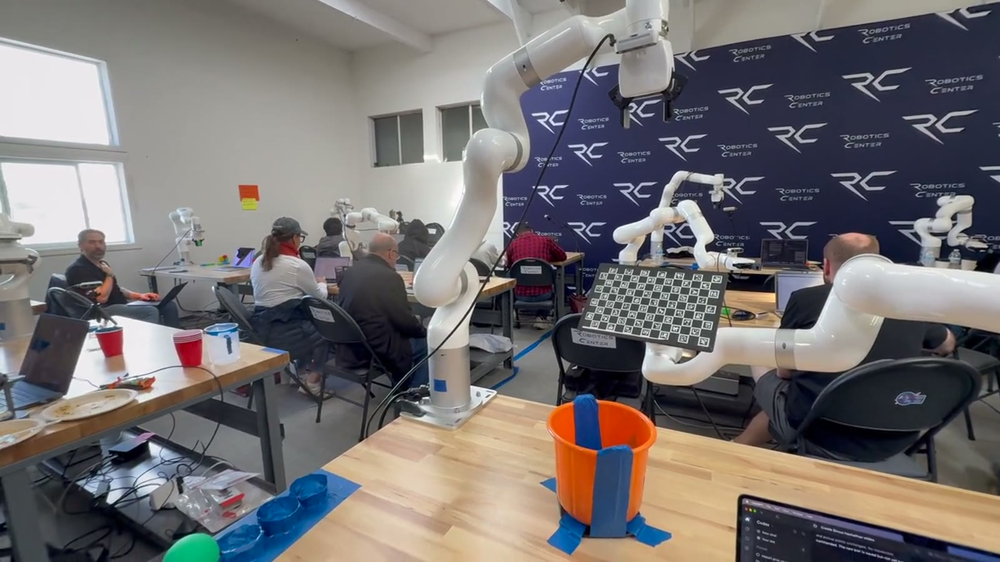

# Kadir Uyanik

### Robotics software, from sensing to motion.

I build software that helps robots perceive, move and interact with people. My work spans 15+ years of research, startups and hands-on integration: teleoperation, calibration, simulation, robot learning and live performance.

Based in San Francisco. **C++ · Python · ROS / ROS 2 · Linux · robot systems integration.**

*Watch the robotics reel. The image shows the Sircus physical prototype; project pages distinguish physical demonstrations from simulation results.*

[Video reel](https://vimeo.com/kadiru/robotics-portfolio) · [LinkedIn](https://www.linkedin.com/in/kadiru/) · [Email](mailto:kadir@scirobot.com) · [Project films](https://vimeo.com/kadiru)

## Research in progress

These projects ask specific questions, publish the evidence, and keep the unfinished parts visible.

| Project | The question | What you can inspect |
| --- | --- | --- |
| **[AI Worker pouring](https://github.com/kadiru/aiworker-pouring)** | Can a robot fill a cup, recognize the stopping condition and return the bottle? | Camera-guided manipulation, a hybrid controller and strict trial scoring in Isaac Sim |
| **[Humanoid sitting and leaning](https://github.com/kadiru/humanoid-sitting-control)** | Can a G1 transfer its weight onto a support and remain balanced? | Depth-based support estimation, reference motions, PPO corrections and contact evaluation in Isaac Lab |
| **[Sircus](https://github.com/kadiru/sircus)** | Can two arms bounce a ball into a bucket after the target moves? | Reachability, shot planning and first-drop evaluation; separate physical and simulation workflows |
| **[RoboTurk](https://github.com/kadiru/metu-ros-pkg/tree/master/stacks/robocup_ssl)** | How can a team find space, win the ball and coordinate a play? | Original robot-soccer research and the ongoing ROS 2/Webots successor with matched skill comparisons |

## Robots meeting people

| Project | What I worked on | See it |
| --- | --- | --- |
| **[Susan the Hexapod](https://github.com/kadiru/susan-the-hexapod)** | Restore actuator control, rebuild firmware and turn movement into playable cues for AXIS Dance Company's *Kinematic / Kinesthetic* | [Performance](https://vimeo.com/kadiru/hexapod-with-dancers) |
| **[Emcee — Reachy Mini × temi](https://github.com/kadiru/Emcee)** | Robotics and XR integration for a remotely operated event-host prototype, with Varun Bhargava and Ryota | [Prototype](https://vimeo.com/kadiru/demo-reachy-reach) |
| **[Irona](https://github.com/kadiru/irona)** | Connect a local language model, cloud speech and a native temi player through an explicit turn pipeline | [Implementation and verification](https://github.com/kadiru/irona) |

## Where the work began

At **KOVAN / EU FP7 ROSSI**, I worked on iCub perception, affordance learning, language grounding and human-aware planning. The [research archive](https://github.com/kadiru/metu-ros-pkg/tree/master/stacks/affordance_learning) connects the code to the original papers and credits the full research team.

I also co-founded **sciRobot**, developing social companion robot prototypes and piloting interactions in care homes, and founded **iamcircus**, bringing technology into community art. [Social robots](https://vimeo.com/kadiru/social-companion-robots) · [Community art](https://vimeo.com/kadiru/tech-enabled-collective-art)

My [machine-learning coursework](https://github.com/kadiru/udacity-mlnd-projects) remains a separate learning archive. Forks on this account retain their upstream authorship; the projects above are the best starting points for reviewing my work.

---

I care about the whole path: a clear problem, a working system, an honest test, and an interaction that makes sense to a person.
